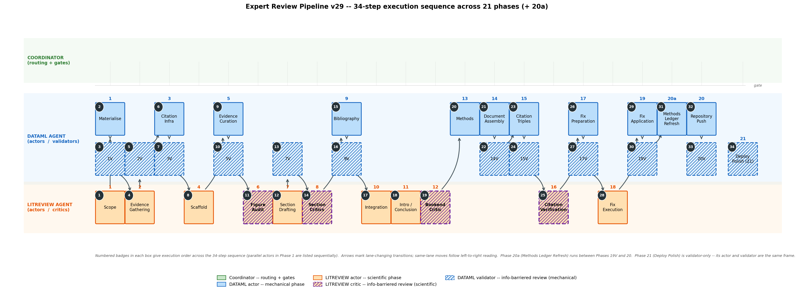

# Computational Review Template

[](https://doi.org/10.5281/zenodo.21213212)

Template repository for producing comprehensive AI-assisted critical literature reviews using the Expert Review Pipeline v30 with TRUST claim tagging and claim-knowledge-base construction.

## Pipeline Overview



The pipeline executes 21 phases with **actor-critic separation** — 20 production phases (scoping through repository push) followed by Phase 21 deploy-polish, a post-deployment UX gate — section writers cannot see how they will be critiqued, figure auditors cannot see the argument arc, and citation verifiers cannot see the fix protocol. This prevents agents from gaming evaluation criteria while the TRUST layer remains validator-driven.

## Quick Start

Runs on Claude Science with **nothing to install** — no agent profiles, no published skills.
The coordinator reads the pipeline skills straight from this repository's `skills/` folder
(see "Runtime: Claude Science" in `skills/comprev-orchestrator.md`).

**Requirements.** "Nothing to install" covers the pipeline skills, not the site build. The
session environment needs `node` ≥ 18 with `npm` — `myst build` runs at Phases 14, 19V and 21 —
and `python` ≥ 3.9 for the figure notebooks and `scripts/`. GitHub Actions supplies both for
the deployed site. Confirm a missing tool with captured command output before recording it as
absent: a wrong "node is unavailable" note once deferred the first real build by five phases.

**Platform.** The skills assume the Claude Science host API — `host.delegate` for sub-agents,
`host.artifacts` for version-pinned skill passing, artifact markers inside delegation tasks.
The *protocol* (phases, gates, information barriers, validator checks) is portable; those
orchestration calls are not, so an agent on another platform must map them to its own
equivalents before any of this runs.

1. **Create a new repo** from this template (Use this template → Create a new repository)
2. **Make the new repo yours.** Six files carry this template's identity, and a review that
   leaves them untouched publishes the template's DOI, copyright and links as its own:
   - `myst.yml` — `title`, `description`, `keywords`, the `github:` URL, and `site.title` / `site.nav` GitHub URL
   - `.github/workflows/deploy.yml` — `BASE_URL: /<your-repo-name>`
   - `content/authors.yml` — real author names and affiliations (Phase 20V fails on placeholders)
   - `README.md` — replace or delete the DOI badge and the How to Cite block; both point at
     *this template's* Zenodo record, not your review
   - `LICENSE` — the copyright holder
   - `.github/ISSUE_TEMPLATE/config.yml` — add your own contact link if you want one
3. **Enable GitHub Pages**: Settings → Pages → Source: **GitHub Actions**. Creating a repo from
   a template does not enable it, and the deploy job fails without it.
4. **Connect GitHub** in Claude Science (Customize → Credentials) with push access to the new repo
5. **Start a new session** and paste your review prompt:

```
Start a comprehensive critical literature review titled: "[YOUR TITLE]"

GitHub Repository: https://github.com/[YOUR-ORG]/[YOUR-REPO]
Clone it into the workspace. The files in its skills/ folder define the complete pipeline;
nothing needs to be installed — follow the "Runtime: Claude Science" section of the orchestrator.

skills/comprev-orchestrator.md — The coordinator protocol. Read this FIRST.
It defines the routing across 21 phases, gate artifacts, and the session protocol.
Per-phase rules live in the agent skills, which the coordinator passes to sub-agents.

skills/comprev-reviewer-agent.md — The worker skill for LITREVIEW roles.
Pass it to every LITREVIEW delegation.

skills/comprev-figure-construction.md — Section writers use it for figure production.

Push all outputs to this repo in Phase 20.

Evidence parameters: [OPTIONAL — omit for defaults]
- Target ≥200 papers per cluster, snowball 2 rounds
- Saturation criterion: <2% new unique in last 100
- Total bibliography target: ≥1000

Table of Contents:
1. Introduction
2. [Your Section 2]
3. [Your Section 3]
...
N. Conclusion
```

6. The pipeline populates `content/`, `evidence/`, `figures/`, and `provenance/`
7. GitHub Actions builds and deploys the MyST site to GitHub Pages

## What's Included

### Skills (22 files in `skills/`)

The pipeline is split into role-specific skills with **information barriers** to enforce actor-critic separation. Worker skills produce content; validator skills run after each phase as blinded gates that emit named pass/fail checks into the gate JSON.

LITREVIEW and DATAML are **roles**, not agent profiles: each phase is delegated to a default
sub-agent that is handed the listed skill files. Every skill file carries YAML frontmatter, so
it can optionally be published from Customize → Skills, but this is not required.

**Worker skills (14):**

| Skill | Phase | Role | Barrier |
|-------|-------|------|---------|
| `comprev-orchestrator` | All | Coordinator | Sees everything |
| `comprev-scoping` | 1 | LITREVIEW | No barriers (first phase, sees user prompt) |
| `comprev-evidence-gathering` | 2 | LITREVIEW | Cannot see critic/writing criteria |
| `comprev-scaffold` | 4 | LITREVIEW | Cannot see critic criteria |
| `comprev-figure-audit` | 6 | LITREVIEW | Blinded — no scaffold or argument arc |
| `comprev-section-writing` | 7 | LITREVIEW | Cannot see critic criteria |
| `comprev-critic` | 8, 12 | LITREVIEW | Blinded — no scaffold or writing template |
| `comprev-integration` | 10–11 | LITREVIEW | Full visibility (integration role) |
| `comprev-verification` | 16 | LITREVIEW | Cannot see fix protocol |
| `comprev-fix-execution` | 18 | LITREVIEW | Cannot see verification criteria |
| `comprev-dataml-phases` | 1, 3, 5, 9, 13–15, 17, 19–20 | DATAML | No barriers (mechanical work) |
| `comprev-reviewer-agent` | 2, 4, 6–8, 10–12, 16, 18 | LITREVIEW | Evidence & writing procedures |
| `comprev-figure-construction` | 7 | LITREVIEW | Figure production |
| `comprev-writing-style` | 7, 8, 11, 12, 18 | LITREVIEW | Prose rules; the standard the critics apply to writing |

**Validator skills (8):**

| Skill | Phase | Role | What it gates |
|-------|-------|------|---------------|
| `comprev-scoping-validator` | 1V | DATAML | Scope JSON, evidence-parameters consistency, plan structure, prompt-verbatim provenance |
| `comprev-evidence-validator` | 2V | DATAML | Evidence-package schema, per-cluster coverage, fulltext rate |
| `comprev-curation-validator` | 5V | DATAML | Per-section evidence package size, conflict and figure-data presence |
| `comprev-citation-validator` | 3V, 9V | DATAML | citation_key_map (Phase 3) and BibTeX (Phase 9) — DOI resolution, CrossRef matching, key uniqueness, author match |
| `comprev-triples-validator` | 15V, 17V | DATAML | One triple per `{cite:p}`/`{cite:t}` occurrence, no sampling |
| `comprev-trust-score-validator` | 16T | DATAML | Dedicated TRUST scoring gate: component scoring, cap-rule enforcement, and claim-graph refresh |
| `comprev-myst-validator` | 7V, 14V, 19V, 20V | DATAML | MyST build, structural checks, figure/heading consistency, plugin-directive invocation, evidence-package population, directive whitelist (7V/19V), repo-wide forbidden-lexicon glob (19V), author-identity placeholder check (20V) |
| `comprev-deploy-polish` | 21 | DATAML | Post-deployment UX gate: tier-A static checks against built Pages-artifact tarball; tier-B live-URL checks (per-page HTTP, external link health) with manual-checklist fallback when deploy URL is sandbox-inaccessible |

### Plugins

| Plugin | What it does |
|--------|-------------|
| `authorship-plugin.mjs` | Renders interactive CRediT authorship widget (local fork plugin; see *Authorship integration boundary* below) |
| `evidence-explorer-plugin.mjs` | Loads evidence packages into interactive browser through the versioned contract (`evidence/schema/`) or the Phase 5 adapter, with explicit `:availability:` and loader diagnostics (`evidence/README.md`) |
| `figure-lightbox-plugin.mjs` | Click-to-zoom lightbox for inline figures |
| `trust-claim-plugin.mjs` | Renders margin trust claim-tags with expandable evidence and score context |
| `human-review-plugin.mjs` | Pairs accepted human comments with exact versioned claim/text anchors as a separate, non-numeric review layer. **Opt-in:** not registered in `myst.yml` by default; `scripts/check_template_consistency.py` names it in `OPTIONAL_PLUGINS` and fails if example acceptances are bound |

#### Authorship integration boundary

Upstream ComputationalReviewTemplate now loads a remote AuthorshipExtractor release and
ships named human authors in `content/authors.yml`. This fork deliberately does neither:
it keeps the local `plugins/authorship-plugin.mjs`, `content/authorship-widget.*` and its
own `content/authors.yml`, because the CRediT companion (`scripts/contributorship/`)
imports the plugin's `parseMiniYaml` and its golden outputs are bound to those bytes, and
because a mutable `releases/latest` URL would make the rendered authorship unreproducible.
`tests/authorship-integration-boundary.test.mjs` pins the boundary. Upstream authorship
changes are adopted only by porting them into the local plugin, with tests.

### Knowledge Base (`knowledge/`)

The TRUST upgrade adds a repository-level claim knowledge model:
- `knowledge/schemas/claim_context.schema.json` - canonical claim object schema
- `knowledge/schemas/trust_score.schema.json` - TRUST component and overall scoring schema
- `knowledge/schemas/claim_graph.schema.json` - graph-level schema for claim relations
- `knowledge/TRUST_RUBRIC.md` - mechanical scoring rubric and score-cap rules
- `knowledge/examples/claim_context.example.json` - concrete claim-context example

### Living review infrastructure

The template includes repository-local proofs of concept for iterating a
published computational review without silently rewriting its knowledge state:

- accepted human submissions are bound to an exact review version, manifest
  digest, claim ID, or exact text selector;
- Evidence Radar maps new works and integrity alerts to advisory claim-level
  proposals without changing citations, prose, or TRUST scores;
- the autonomous revision planner groups proposals into dependency-ordered,
  human-gated PR themes;
- release tooling produces a frozen scientific diff, an RO-Crate 1.3 evidence
  capsule, and provenance-bearing federated claim JSON-LD; and
- immutable artifact indexes provide the ingest boundary for a future
  arXiv-style computational-review registry.

The architecture and authority boundaries are documented in
`docs/HUMAN_REVIEW_AND_PUBLICATION.md`, `docs/AUTONOMOUS_TRUST_AGENTS.md`,
`docs/EVIDENCE_RADAR.md`, `docs/RELEASE_ARTIFACTS.md`,
`docs/ORATLAS_EXPORT.md` (ORAtlas-compatible claims/citations/relations export), and
`docs/CONTRIBUTORSHIP.md` (optional CRediT contributorship and source-finding credit
companion; humans and software agents are credited through separate channels).

```bash
node scripts/validate-community-contracts.js
node scripts/evidence-radar.mjs --config config/evidence-radar.json --feed tests/fixtures/evidence-radar/feed.json --output evidence-radar-output/proposals.json
node scripts/plan-review-backlog.mjs evidence-radar-output/proposals.json
node --test tests/*.test.mjs
```

### Content placeholders (`content/`)

Pre-configured pages that the pipeline populates:
- `00_frontmatter.md` — Abstract + authorship explorer
- `01_introduction.md` — Placeholder (written in Phase 11)
- `Methods.md` — Methods template with pipeline figure
- `evidence_database.md` — Interactive evidence explorer
- `provenance.md` — Pipeline execution summary

### Site infrastructure

- `myst.yml` — MyST configuration with top-bar navigation (Review | Methods | Evidence | Provenance | GitHub)
- `.github/workflows/deploy.yml` — Auto-builds MyST site and deploys to GitHub Pages
- `scripts/shared_style.py` — Common figure style (colors, fonts, 300 DPI)
- `content/authors.yml` — Author metadata for the authorship widget (extended into `myst.yml`)
- `.github/workflows/validate.yml` — deterministic validation with the pinned `mystmd@1.10.1`: evidence contract, compatibility report, generic MyST golden fixture, and a clean-copy build of this TRUST site whose rendered claim, authorship and evidence widgets are inspected (`node --test test/*.test.mjs`). The deploy workflow differs: it installs an unpinned `mystmd` and executes the figure notebooks at build time, so the deployed figures are regenerated rather than byte-checked.

### Compatibility reporting

Assembly writes `provenance/review_compatibility_report.json` covering article rendering,
citation resolution, evidence-package loading and the presence of optional extensions. In
this fork the TRUST claim graph is reported there as an extension with the verbatim
`validate-trust.js` result; the report never assigns or interprets scores. See
[the compatibility-report contract](docs/evidence-compatibility.md).

### Generic MyST fixtures

`test/fixtures/myst-golden` covers citations, bibliography, figures, tables,
cross-references, admonitions, mathematics, margin content, custom directives,
and the Evidence Explorer directive using the production plugin and widget. It
deliberately avoids TRUST and claim-graph semantics; `test/trust-site-render.test.mjs`
covers those on the real site. Install the pinned CLI with
`npm install --global mystmd@1.10.1`, then run `node --test test/*.test.mjs`
(set `MYST_COMMAND` only when the CLI is installed under a non-standard name).

## Pipeline Architecture

**Act 1 — Evidence & Infrastructure** (Phases 1–6): Define scope, gather evidence from literature databases (PubMed, OpenAlex, bioRxiv), build citation infrastructure from CrossRef, construct the review scaffold, curate per-section evidence packages, and audit figure comparisons for methodological validity.

**Act 2 — Drafting & Criticism** (Phases 7–13): Draft sections in parallel (max 4 agents), run blinded 6-track criticism, build bibliography from CrossRef, perform 6-pass integration for consistency, write introduction/conclusion/abstract, run blinded bookend critic on intro/conclusion, and generate the methods section.

**Act 3 — Assembly, Verification & Deploy** (Phases 14–20): Assemble the complete document, exhaustively extract citation triples (every citation occurrence), verify ALL citations with full-text-first claim checking (DOI resolution, title/author/metadata match, full-text claim verification with supporting passage audit trail), prepare and execute fixes for non-verified citations, apply fixes, and push to GitHub.

**Act 4 — Deploy Polish** (Phase 21): Post-deployment UX gate. Tier-A static checks (forbidden lexicon, author identity, directive rendering, frontmatter leak, figure dropdown completeness, asset paths, plugin data binding, internal link health) run against the built Pages-artifact tarball downloaded via the GitHub API — works on private repositories. Tier-B live-URL checks (per-page HTTP, external link health) downshift to a user-runnable manual checklist when the deployed site is unreachable from the validator sandbox.

### Evidence Parameters

The pipeline's evidence-gathering depth is user-configurable via the prompt. Phase 1 extracts these from your review request:

| Parameter | Default | What it controls |
|-----------|---------|-----------------|
| `min_papers_per_cluster` | 70 | Minimum unique papers per topic cluster |
| `saturation_criterion` | null | Optional stopping rule (e.g., "<2% new unique in last 100") |
| `snowball_rounds` | 0 | Citation-chasing rounds via OpenAlex (forward + backward) |
| `total_bibliography_target` | null | Optional floor for total bibliography across all clusters |

**Saturation mode:** Say "saturate the literature" in your prompt — the pipeline sets `min_papers_per_cluster: null`, `saturation_criterion: "<2% new unique in last 100"`, `snowball_rounds: 2`, and searches until the field is exhausted.

**Quota mode:** Say "≥200 papers per section" — the pipeline gathers at least 200 per cluster via keyword search without snowballing.

**Both:** Specify a floor AND a saturation criterion — the agent must meet the floor AND confirm saturation.

Phase 5 curation floors scale proportionally with your evidence density target.

### Key Design Principles

- **Mechanical citation infrastructure**: All citation keys and author names come from CrossRef API — never from LLM memory. This prevents hallucinated references.
- **Actor-critic separation**: Writers don't know how critics will evaluate them. Critics don't know the intended argument. This prevents gaming.
- **Incremental artifact saves**: Agents save intermediate work before expensive operations. If an agent crashes, partial work survives.
- **Max 4 parallel agents**: Prevents system resource exhaustion from too many simultaneous heavy agents.
- **Gate checkpoints**: Each phase transition requires a named gate artifact. The coordinator verifies compliance before advancing.
- **Full-text citation verification**: Every citation-claim pair is verified against the cited paper's full text (not just abstract). VERIFIED status requires a verbatim supporting passage from the paper. This catches interpretive mismatches where the abstract is topically compatible but the paper's findings contradict the review's claim.
- **Separate human and computational layers**: Human reviewers may support, dispute, or qualify an exact claim, but their judgments are never averaged into the deterministic TRUST score.
- **Proposal-only autonomy**: Agents may discover evidence, map anchors, and plan themed revisions; scientific acceptance, TRUST changes, merges, and releases remain human-gated.

## Versioning

Two version numbers exist and they are deliberately separate.

- **Pipeline generation** (`v30`) — the skill protocol. It lives in `skills/manifest.json`
  and nowhere else that can drift: skill filenames carry no version, and every skill's
  `description` must quote the manifest's number. Bump it with
  `python scripts/build_skill_manifest.py --set-version 30`.
- **Template release** — this repository, versioned by git tag and GitHub release under
  semver. It is deliberately written into no file, so it cannot go stale here; read it with
  `git describe --tags`.

`skills/manifest.json` also records the sha256 and byte count of every skill file, so the
exact protocol bytes a review ran on can be identified after the fact. Regenerate it after
editing any skill:

```bash
python scripts/build_skill_manifest.py          # regenerate
python scripts/build_skill_manifest.py --check  # verify (CI runs this on every PR)
```

`scripts/check_prose_fidelity.py` guards any pass that rewrites existing prose. It compares two
versions and asserts that every citation role, numeric value and cross-reference survived;
`--self-test` verifies the comparator itself against known-equivalent and known-corrupt edits,
and CI runs it on every PR.

```bash
python scripts/check_prose_fidelity.py --self-test
python scripts/check_prose_fidelity.py before.md after.md
```

The check fails on a skill edited without a manifest regeneration, a version-bearing skill
filename, a `name` that disagrees with its filename, a description quoting the wrong
generation, or a README naming a generation the manifest does not.

At session setup the coordinator verifies the manifest and writes
`provenance/pipeline_version.json` into the review repository — pipeline generation, template
commit, template tag, manifest hash, and the per-skill artifact ids the run actually used.
Every later phase that reports a version reads it from there, so a published review states
what produced it rather than what someone typed.

## Customization

- **Title and metadata**: Edit `myst.yml` project title, description, and keywords
- **Authors**: Edit `content/authors.yml` to add human contributors alongside the AI author
- **Figure style**: Edit `scripts/shared_style.py` to change colors, fonts, and figure aesthetics
- **Navigation**: The top bar (Review | Methods | Evidence | Provenance | GitHub) is configured in `myst.yml` site.nav

## License

MIT

## How to Cite

If you use this template in your research, please cite:

```bibtex
@software{lecoq_2026_21213212,
  author       = {Jérôme Lecoq},
  title        = {AllenNeuralDynamics/ComputationalReviewTemplate},
  year         = 2026,
  publisher    = {Zenodo},
  doi          = {10.5281/zenodo.21213212},
  url          = {https://doi.org/10.5281/zenodo.21213212}
}
```

> Lecoq, J. (2026). *AllenNeuralDynamics/ComputationalReviewTemplate*. Zenodo. https://doi.org/10.5281/zenodo.21213212

That DOI is the *concept* DOI: it always resolves to the most recent release, so it needs no
update when a version is cut. To cite one specific version instead, take that version's own
DOI from the Zenodo record.

## Offline private artifact descriptor

The optional [producer draft](docs/PRIVATE_PROJECT_ARTIFACTS.md) for TRUST #16
checks exact local artifact hashes and emits a private descriptor. It grants no
source access and does not publish content or change the public review exporter.
